<!-- ===================== BANNER ===================== -->

 

---

### _My Current Role_

<table align="center">
  <tr>
    <td align="center" width="140">
      
    </td>
    <td><b>Co-founder, SHE4TECH</b></td>
  </tr>
  <tr>
    <td align="center" width="140">
      
    </td>
    <td>Mentoring and community management</td>
  </tr>
  <tr>
    <td align="center" width="140">
      
    </td>
    <td>Empowering women and girls in tech through learning, mentorship and community.</td>
  </tr>
</table>

---

### _My Tech Stack, Tools and Os Explored_

<!--<table>
  <tr>
    <td><b>Front-end</b></td>
    <td>
      
      
      
      
    </td>
  </tr>
  <tr>
    <td><b>Back-end</b></td>
    <td>
      
      
      
      
    </td>
  </tr>
  <tr>
    <td><b>Frameworks &amp; libraries</b></td>
    <td>
      
      
      
    </td>
  </tr>
  <tr>
    <td><b>Databases</b></td>
    <td>
      
      
      
    </td>
  </tr>
  <tr>
    <td><b>CMS</b></td>
    <td>
      
    </td>
  </tr>
</table>-->

  
  
  

    
   
     
     
     
  

---

### _Languages_

  
  
  
  

<!--### _Current Focus_-->

### _Contact Me_

  
  
  

*Thanks for stopping by, leave a* ⭐ *if you like something!* 

